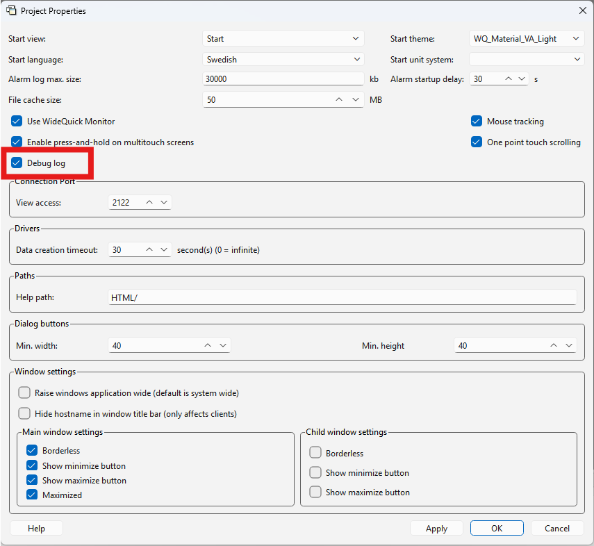

# Skicka SMS med Teltonika – Användning Generellt

I detta kapitel beskrivs hur pluginet anropas från skript i WideQuick för att skicka SMS. I ett projekt som är byggt på Modular Framework sköts konfigurationen istället från vyn Inställningar, se [Användning Modular Framework](anvandning-mod.md).

## Registrera pluginet i projektet

Pluginet är en .NET-DLL, `KentimaSmsClient.dll`, som behöver registreras i projektet innan skripten kan anropa det.

1. Lägg `KentimaSmsClient.dll` i projektkatalogen, gärna i en egen underkatalog.
2. Högerklicka på noden **Plugins** i projektträdet i WideQuick Designer och välj **Lägg till plugin**.
3. Ange namnet `KentimaSmsClient` och peka ut DLL-filen med en relativ sökväg.

!!! note "Namnet ingår i varje anrop"
    Namnet som anges i dialogen är det som skripten använder för att nå pluginet. Alla anrop på den här sidan börjar med `KentimaSmsClient.KentimaSmsClient.`, där den första delen är namnet från dialogen och den andra pluginets namnrymd. Väljs ett annat namn behöver anropen ändras på samma sätt.

!!! warning "Använd en relativ sökväg"
    En absolut sökväg fungerar bara på datorn där pluginet lades till. På andra datorer laddas pluginet inte, och det första anropet misslyckas med ett fel om att `KentimaSmsClient` saknas (`base is null`).

## Skapa ett skript för att konfigurera anslutningen till routern

Det rekommenderas att lägga konfigurationen i en egen skriptmodul. På så vis krockar den inte med, eller påverkar, andra skriptfunktioner i projektet. Eventuell felsökning och uppgradering underlättas också.

1. Skapa ett nytt skript i WideQuick Designer genom att högerklicka på **Skriptbibliotek** och välja **Lägg till skript...**.
2. Ge skriptet ett lämpligt namn, t.ex. `scSMS`, och ställ in det enligt tabellen:

    | Inställning | Värde |
    |-------------|-------|
    | **Priority** | `0`, om ingen annan ordning används i projektet. |
    | **Load script** | Kan behållas på **Före mainView.onLoad (Default)**, eftersom skriptet inte behöver någon grafik. |
    | **Remote** | **Do not run the script on remote clients**. |

    !!! warning "Kör inte skriptet på fjärrklienter"
        Körs skriptet även på fjärrklienter (WideQuick Remote och WideQuick Web Client) konfigurerar varje ansluten klient en egen instans av pluginet och registrerar egna larmlyssnare. Ett larm skickas då som SMS en gång från servern och en gång till från varje klient. En klient behöver dessutom ha DLL-filen installerad lokalt för att kunna ladda pluginet.

3. Klistra in följande skript:

    ```javascript
    try
    {
        // Stänger av certifikatvalideringen, kan plockas bort om ett giltigt certifikat importeras
        KentimaSmsClient.KentimaSmsClient.RestClient.SetIgnoreCertificateErrors(true);

        // Anger anslutningsuppgifter för routern: url, användarnamn och lösenord.
        KentimaSmsClient.KentimaSmsClient.SmsClient.Configure(_url_, _användarnamn_, _lösenord_);

        // Testar att anslutningen till routern faktiskt fungerar med de angivna uppgifterna.
        var testConnectionStatus = KentimaSmsClient.KentimaSmsClient.SmsClient.TestConnection();

        if (!testConnectionStatus)
        {
            // Anslutningen misslyckades, skriv felmeddelandet till Debug.log.
            Debugger.log(KentimaSmsClient.KentimaSmsClient.SmsClient.GetLastError());
        }
        else
        {
            // Anslutningen lyckades.
            Debugger.log("Koppling till Teltonika Router fungerar!");
        }
    }
    catch (error)
    {
        // Pluginet gick inte att anropa, t.ex. för att det inte är registrerat i projektet.
        Debugger.log("scSMS: " + error.message);
    }
    ```

    !!! info "Varför krävs SetIgnoreCertificateErrors?"
        Teltonika-routerns webbaserade API använder som standard ett självsignerat certifikat, utfärdat för ett värdnamn baserat på routerns MAC-adress (t.ex. `Teltonika001122334455`) och inte för den lokala IP-adress (t.ex. `192.168.1.1`) som pluginet ansluter till. Certifikatet är därför varken betrott av datorn som kör WideQuick eller giltigt för adressen som anropas, så .NET:s inbyggda certifikatvalidering skulle annars avvisa anslutningen.

        `SetIgnoreCertificateErrors(true)` stänger av denna validering så att anslutningen ändå tillåts. Nackdelen är att skyddet mot man-in-the-middle-attacker försvinner, men eftersom anslutningen sker mot routern över ett lokalt nätverk anses risken normalt vara acceptabel.

        Vill man slippa stänga av valideringen helt går det istället att skapa ett certifikat som är giltigt för routerns IP-adress, se [Certifikat giltigt för routerns IP-adress](avancerat.md#certifikat-giltigt-for-routerns-ip-adress) under Avancerat.

4. Uppdatera `Configure()` med routerns uppgifter, samma som när [användaren skapades på routern](installation.md#skapa-en-anvandare). Exempelvis:

    | Argument | Värde |
    |----------|-------|
    | url | `"https://192.168.1.1"` |
    | användarnamn | `"sms"` |
    | lösenord | lösenordet för användaren som skapades på routern |

    !!! warning "Använd https, inte http"
        Anslut alltid till routern via `https://` istället för `http://`, så att inloggningsuppgifter och kommunikation inte kan läsas av utomstående på nätverket. Nyare versioner av RutOS inaktiverar dessutom http som standard och tvingar fram https, så en anslutning via http kan sluta fungera helt efter en firmware-uppdatering.

    !!! note "Configure() går att anropa flera gånger"
        Ett upprepat `Configure()`-anrop med oförändrade uppgifter gör ingenting, så funktionen kan anropas igen, t.ex. från en inställningsvy, utan att anslutningen störs. Ändras url, användarnamn, lösenord eller modem-id byggs anslutningen om, och meddelanden som just då ligger kvar i den gamla kön överges.

5. Starta WideQuick Runtime, eller starta om den om den redan körs. En skriptmodul körs bara en gång, när Runtime startar. Öppna sedan `Log\Debug.log` i projektkatalogen. Om allt har gått rätt till står `Koppling till Teltonika Router fungerar!` i loggen.

    !!! warning "Aktivera felsökningsloggen"
        `Debug.log` skrivs bara när felsökningsloggen är aktiverad i projektet. Högerklicka på projektet i projektträdet, välj **Properties** och kryssa i rutan **Debug Log** innan Runtime startas.
        

### Val av modem vid flera SIM-kort

`Configure()` finns i två varianter: en som tar tre argument (`url`, `användarnamn`, `lösenord`) och en som tar fyra (samma tre, plus `id`). Exemplet ovan använder tre-argumentsvarianten.

Med tre argument frågar pluginet routern vilket modem som ska användas för att skicka SMS:

- **En router med ett SIM-kort** har bara ett modem att välja mellan. Routern svarar automatiskt med dess id, och pluginet använder det utan att någon ytterligare konfiguration behövs.
- **En router med två SIM-kort** (t.ex. RUTX-serien) har två möjliga modem, och pluginet kan då inte avgöra vilket som ska användas. `GetLastError()` returnerar i det läget ett felmeddelande som listar namnen på de två modemen, och skriptet ovan skriver det till `Debug.log`.

I det senare fallet behöver `Configure()` istället anropas med fyra argument, där det fjärde är id:t för det modem som ska användas för utskicket: `Configure(_url_, _användarnamn_, _lösenord_, _id_)`.

Modem-id:t kan även tas fram direkt på routern, via SSH eller CLI-fönstret i webbgränssnittet, med kommandot `ubus call mctl list`.

## Skicka ett SMS med routern

När kommunikationen med routern fungerar går det att skicka SMS. Det finns två funktioner för detta, `SendSms()` och `SendSmsWait()`, som skiljer sig åt i hur de hanterar utskicket:

| Funktion | Beteende |
|----------|----------|
| `SendSms()` | Asynkron. Utskicket läggs i en kö och skickas när modemet hinner med det, utan att skriptet stannar upp och väntar. Nackdelen är att funktionen inte returnerar något `true`/`false` som visar om utskicket faktiskt lyckades. |
| `SendSmsWait()` | Synkron. Skriptet väntar tills utskicket är genomfört och funktionen returnerar `true` eller `false` beroende på om det lyckades. |

Båda funktionerna tar samma två argument, båda strängar: telefonnummer och den text som ska skickas, t.ex. `SendSms(_telefonnummer_, _text_)`.

!!! note "Format på telefonnumret"
    Telefonnumret behöver inte anges i internationellt format, ett vanligt lokalt nummer fungerar också. Internationellt format (t.ex. `+46701234567`, med landskod och `+`) rekommenderas ändå, för att undvika oklarheter kring vilket land numret hör till.

Text längre än 160 tecken delas upp i flera SMS (standard GSM-segmentering), vilket är värt att ha i åtanke eftersom det kan påverka kostnaden per utskick beroende på operatörens prissättning.

!!! note "Långa meddelanden"
    Routern tar emot högst 8 SMS-delar per utskick och avvisar längre meddelanden. Ett enda tecken utanför GSM-alfabetet, t.ex. typografiska citattecken eller tankstreck från en inklistrad larmtext, gör att varje del bara rymmer 67 tecken istället för 153. Dela upp långa texter på flera `SendSms()`-anrop.

Misslyckas ett köat utskick (`SendSms()`) görs det om ytterligare tre gånger, med 15 sekunders mellanrum, innan det kasseras.

!!! warning "Lägg inte SendSms i en dynamik eller en återkommande timer"
    Ett skript i en dynamik utvärderas om och om igen medan vyn visas, och en `Timer` som inte är single shot körs vid varje intervall. Ligger anropet till `SendSms()`/`SendSmsWait()` där skickas ett nytt SMS vid varje körning, vilket leder till ett väldigt stort antal utskick. Anropet måste istället kopplas till en händelse, t.ex. `onDataChanged` på en `DataStoreListener` eller ett klick på en knapp, så att ett SMS bara skickas när händelsen faktiskt inträffar.

!!! note "Varför kan anropet ligga direkt i scSMS?"
    En skriptmodul som `scSMS` körs bara en gång, när WideQuick Runtime startar. Det är därför ett `SendSms()`-anrop kan ligga direkt i skriptet utan att skicka SMS om och om igen (se [Snabbtesta hela kedjan](#snabbtesta-hela-kedjan) nedan), men aldrig i en dynamik eller en återkommande timer.

Välj `SendSmsWait()` om skriptet behöver veta om SMS:et faktiskt skickades, och `SendSms()` om det räcker att lägga utskicket i kö utan att invänta resultatet. `SendSmsWait()` blockerar skriptmotorn medan den väntar, i värsta fall i ungefär 80 sekunder (se `RestClient.SetTimeoutSeconds()` under [Funktionsreferens](avancerat.md#funktionsreferens)). Använd därför `SendSms()` i larmlyssnare.

### Snabbtesta hela kedjan

Om man vill kan man lägga till följande skriptrad i `scSMS`, inuti `try`-blocket efter `Configure()`:

```javascript
KentimaSmsClient.KentimaSmsClient.SmsClient.SendSms(_telefonnummer_, _meddelande_);
```

Då skickas ett SMS varje gång WideQuick Runtime startar, vilket låter en snabbt verifiera att hela kedjan, anslutning, autentisering och utskick, fungerar från WideQuick.

!!! note "Plocka bort raden efteråt"
    Ta bort raden igen när testet är genomfört. Ligger den kvar i `scSMS` skickas ett nytt SMS varje gång Runtime startar.

## Exempel på användning

Exemplen läggs i `scSMS`, efter konfigurationen. Lyssnaren sparas på skriptobjektet (`this`), eftersom variabler som bara skapas med `var` i en skriptmodul försvinner när skriptet har kört klart.

### Ett enskilt larm

Nedan skickas ett SMS när larmet `MittLarm` i larmgruppen `MinLarmgrupp` går aktivt. En `DataStoreListener` registreras på larmet, och dess `onDataChanged` anropas när larmets tillstånd ändras, inte cykliskt. SMS skickas bara när larmet är aktivt och ännu inte kvitterat, så en kvittering eller ett larm som går tillbaka ger inget nytt SMS:

```javascript
// Händelselyssnare på larmet
this.larmLyssnare = new DataStoreListener();
this.larmLyssnare.register(MinLarmgrupp.MittLarm);

this.larmLyssnare.onDataChanged = function (event)
{
    var changedData = event.data();
    for (var namn in changedData)
    {
        var larm = changedData[namn];
        // Larmet har gått aktivt och är ännu inte kvitterat
        if (larm && !larm.acknowledged)
        {
            KentimaSmsClient.KentimaSmsClient.SmsClient.SendSms(_telefonnummer_, "Larmet: " + namn + " har gått aktivt!");
        }
    }
};
```

### Alla larm i projektet

Samma lyssnare kan i stället registreras på alla larm i projektet. Funktionen `registreraLarm` går igenom DataStore, även nästlade larmgrupper, och registrerar varje larm i varje larmgrupp. Den måste definieras innan den anropas:

```javascript
// Registrerar alla larm i alla larmgrupper, även nästlade grupper
this.registreraLarm = function (obj)
{
    for (var namn in obj)
    {
        var del = obj[namn];
        if (del instanceof AlarmGroup)
        {
            for (var larm in del)
            {
                this.larmLyssnare.register(del[larm]);
            }
        }
        else if (del instanceof Object && typeof del === "object")
        {
            this.registreraLarm(del);
        }
    }
};

// Händelselyssnare på alla larm
this.larmLyssnare = new DataStoreListener();
this.registreraLarm(DataStore);

this.larmLyssnare.onDataChanged = function (event)
{
    var changedData = event.data();
    for (var namn in changedData)
    {
        var larm = changedData[namn];
        // Har larmet gått aktivt
        if (larm && !larm.acknowledged)
        {
            KentimaSmsClient.KentimaSmsClient.SmsClient.SendSms(_telefonnummer_, "Larmet: " + namn + " har gått aktivt!");
        }
    }
};
```
