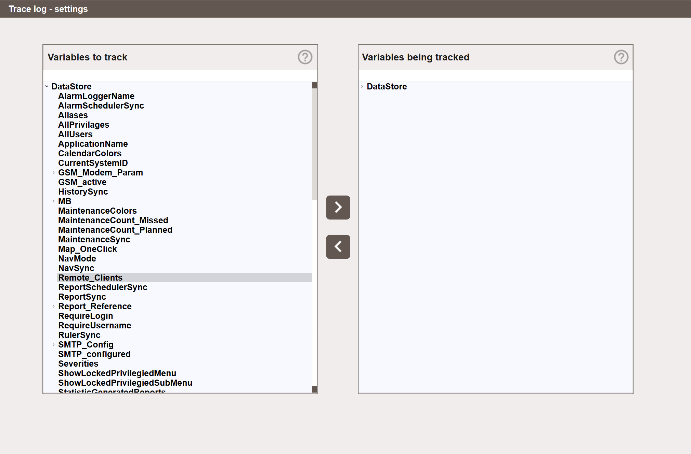

<!-- --8<-- [start:body-1] -->

# Audit Trail - Configuring

## Configuring Variables to Track { #configuring-variables-to-track }

Navigate to **History → Logs → Audit Trail → Audit Trail - Settings**.
<!-- --8<-- [end:body-1] -->

{align=center}

<!-- --8<-- [start:body-2] -->
The view has two panels. The left panel, **Variables to track**, shows all available Data Store variables. The right panel, **Variables being tracked**, shows the variables currently being tracked.

To start tracking a variable, select it in the left panel and click the **>** button. To stop tracking a variable, select it in the right panel and click the **<** button. Variables can also be added/removed by double-clicking.

Variables can be added at any level of the Data Store tree. Selecting a parent node and clicking **>** adds all variables under that node at once.

A filter field above each panel narrows its tree to matching variables. The filter also limits what **>**, **<** and double-click do: adding or removing a parent node only takes the variables under it whose path contains the filter text.

### Variables that no longer exist { #variables-that-no-longer-exist }

A tracked variable that no longer exists in the Data Store, for example after a tag was renamed or removed, stays in the list and is marked with an icon in the right panel. The nodes above it are marked with a grey exclamation mark, so it can be found in a collapsed tree. A missing variable is not logged.

While at least one tracked variable is missing, the **Delete all missing signals** button is shown below the right panel. It asks for confirmation, showing how many variables will be removed, and then removes all of them from the list. This cannot be undone.

!!! warning
    Avoid tracking variables that change continuously, such as measured values and sensor readings. This will generate a very large number of log entries and make the log difficult to use. The Audit Trail is intended for variables that change infrequently and deliberately, such as setpoints, control signals, and configuration values.
<!-- --8<-- [end:body-2] -->
