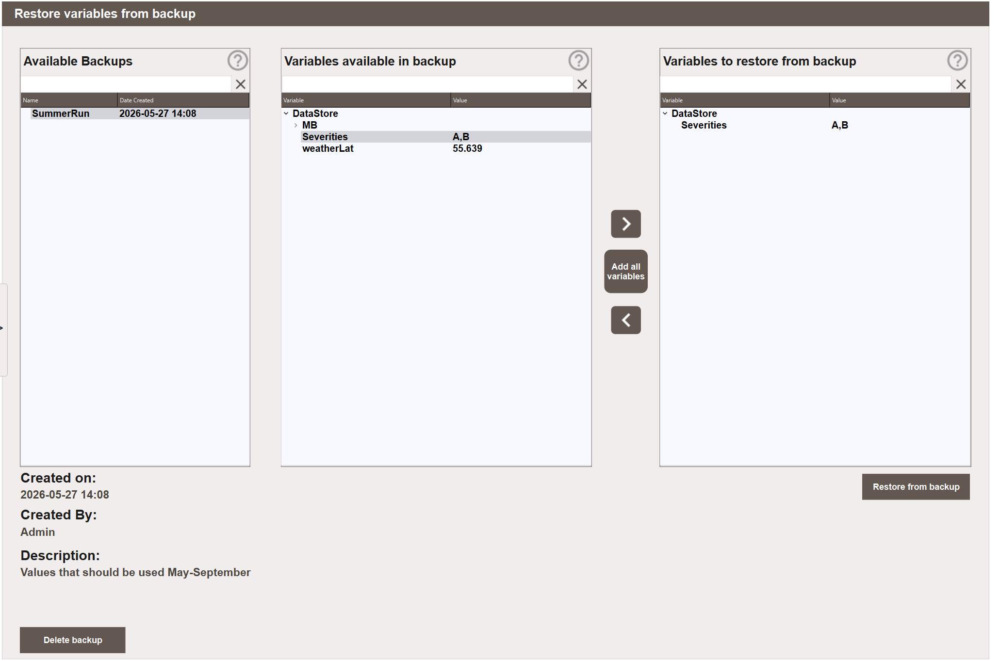
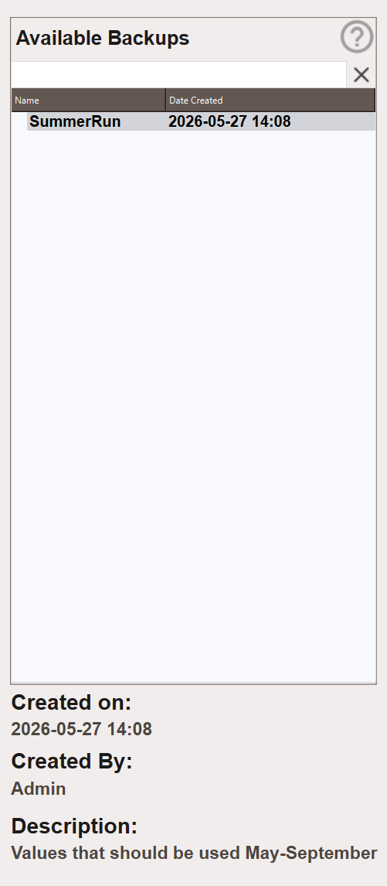

<!-- --8<-- [start:body-1] -->

# Backup and Restore - Configuring

## Restoring a Backup { #restoring-a-backup }

Navigate to **Settings → Backup → Restore**.
<!-- --8<-- [end:body-1] -->

{align=center}

<!-- --8<-- [start:body-2] -->
The view has three panels. The left panel lists all saved backups with their creation date. Selecting a backup shows its metadata below the panels and populates the middle panel with the variables stored in that backup.
<!-- --8<-- [end:body-2] -->

{align=center}

<!-- --8<-- [start:body-3] -->
* **Created on** — the date and time the backup was created.
* **Created By** — the user who created the backup.
* **Description** — the description entered at the time of creation.

The three panels are **Available Backups**, **Variables available in backup** and **Variables to restore from backup**. Each has a filter field at the top, cleared with **X**. As in the create view, the filter also limits what **>**, **<** and double-click take from a parent node.

1. Select a backup from the left panel.
2. Browse or filter the middle panel to find the variables to restore.
3. Double-click a variable, or select it and click **>**, to move it to the right panel. To add all variables at once, click **Add all variables**.
4. Click **Restore from backup**. The stored values are applied immediately, with no confirmation.

Each stored value is converted to the type the variable has now. A variable that no longer exists in the Data Store is skipped, and the skip is written to the error log. The rest of the selection is still restored.

## Deleting a Backup { #deleting-a-backup }

1. Navigate to **Settings → Backup → Restore**.
2. Select the backup to delete from the left panel.
3. Click **Delete backup** and confirm. The backup and all its stored values are permanently removed.
<!-- --8<-- [end:body-3] -->
