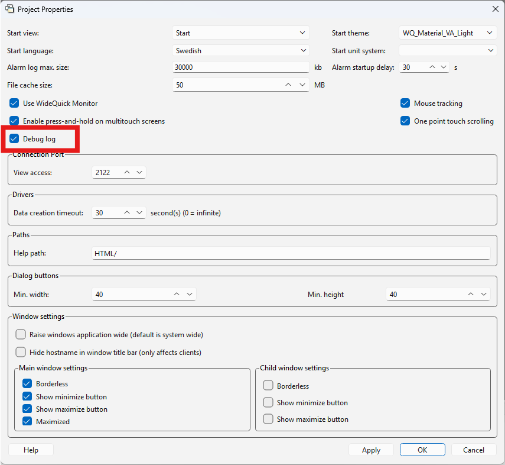

# Send SMS with Teltonika – Usage General

This chapter describes how to call the plugin from scripts in WideQuick to send SMS. In a project built on Modular Framework, the configuration is handled from the Settings view instead, see [Usage Modular Framework](anvandning-mod.md).

## Register the plugin in the project

The plugin is a .NET DLL, `KentimaSmsClient.dll`, which has to be registered in the project before scripts can call it.

1. Place `KentimaSmsClient.dll` in the project directory, preferably in a subdirectory of its own.
2. Right-click the **Plugins** node in the project tree in WideQuick Designer and select **Add plugin**.
3. Enter the name `KentimaSmsClient` and point to the DLL file with a relative path.

!!! note "The name is part of every call"
    The name entered in the dialog is the one scripts use to reach the plugin. Every call on this page starts with `KentimaSmsClient.KentimaSmsClient.`, where the first part is the name from the dialog and the second is the plugin's namespace. If you choose another name, change the calls the same way.

!!! warning "Use a relative path"
    An absolute path only works on the computer where the plugin was added. On other computers the plugin is not loaded, and the first call fails with an error saying that `KentimaSmsClient` is missing (`base is null`).

## Create a script to configure the connection to the router

It is recommended to put the configuration in a script module of its own. That way it does not collide with, or affect, other script functions in the project. It also makes troubleshooting and upgrades easier.

1. Create a new script in WideQuick Designer by right-clicking **Script Library** and selecting **Add script...**.
2. Give the script a suitable name, e.g. `scSMS`, and set it up according to the table:

    | Setting | Value |
    |---------|-------|
    | **Priority** | `0`, unless the project uses another order. |
    | **Load script** | Can be left at **Before mainView.onLoad (Default)**, since the script does not need any graphics. |
    | **Remote** | **Do not run the script on remote clients**. |

    !!! warning "Do not run the script on remote clients"
        If the script also runs on remote clients (WideQuick Remote and WideQuick Web Client), every connected client configures its own instance of the plugin and registers its own alarm listeners. An alarm is then sent as SMS once from the server and once more from every client. A client also needs the DLL file installed locally to load the plugin at all.

3. Paste the following script:

    ```javascript
    try
    {
        // Turns off certificate validation, can be removed if a valid certificate is imported
        KentimaSmsClient.KentimaSmsClient.RestClient.SetIgnoreCertificateErrors(true);

        // Sets the connection details for the router: url, username and password.
        KentimaSmsClient.KentimaSmsClient.SmsClient.Configure(_url_, _username_, _password_);

        // Tests that the connection to the router actually works with the given details.
        var testConnectionStatus = KentimaSmsClient.KentimaSmsClient.SmsClient.TestConnection();

        if (!testConnectionStatus)
        {
            // The connection failed, write the error message to Debug.log.
            Debugger.log(KentimaSmsClient.KentimaSmsClient.SmsClient.GetLastError());
        }
        else
        {
            // The connection succeeded.
            Debugger.log("Connection to the Teltonika router works!");
        }
    }
    catch (error)
    {
        // The plugin could not be called, e.g. because it is not registered in the project.
        Debugger.log("scSMS: " + error.message);
    }
    ```

    !!! info "Why is SetIgnoreCertificateErrors needed?"
        By default, the Teltonika router's web API uses a self-signed certificate, issued for a hostname based on the router's MAC address (e.g. `Teltonika001122334455`) and not for the local IP address (e.g. `192.168.1.1`) the plugin connects to. The certificate is therefore neither trusted by the computer running WideQuick nor valid for the address being called, so .NET's built-in certificate validation would otherwise reject the connection.

        `SetIgnoreCertificateErrors(true)` turns this validation off so the connection is allowed anyway. The downside is that the protection against man-in-the-middle attacks is lost, but since the connection goes to the router over a local network, the risk is normally considered acceptable.

        If you would rather not turn validation off completely, you can instead create a certificate that is valid for the router's IP address, see [Certificate valid for the router's IP address](avancerat.md#certificate-valid-for-the-routers-ip-address) under Advanced.

4. Update `Configure()` with the router's details, the same as when [the user was created on the router](installation.md#create-a-user). For example:

    | Argument | Value |
    |----------|-------|
    | url | `"https://192.168.1.1"` |
    | username | `"sms"` |
    | password | the password of the user created on the router |

    !!! warning "Use https, not http"
        Always connect to the router through `https://` rather than `http://`, so that credentials and traffic cannot be read by others on the network. Newer versions of RutOS also disable http by default and enforce https, so a connection over http may stop working entirely after a firmware update.

    !!! note "Configure() can be called more than once"
        A repeated `Configure()` call with unchanged details does nothing, so the function can be called again, e.g. from a settings view, without disturbing the connection. If the url, username, password or modem id changes, the connection is rebuilt, and any messages still waiting in the old queue at that moment are abandoned.

5. Start WideQuick Runtime, or restart it if it is already running. A script module only runs once, when Runtime starts. Then open `Log\Debug.log` in the project directory. If everything went well, the log contains `Connection to the Teltonika router works!`.

    !!! warning "Turn on the debug log"
        `Debug.log` is only written when the debug log is turned on in the project. Right-click the project in the project tree, select **Properties** and check the **Debug Log** box before starting Runtime.
        
        
### Choosing a modem with several SIM cards

`Configure()` comes in two variants: one taking three arguments (`url`, `username`, `password`) and one taking four (the same three, plus `id`). The example above uses the three-argument variant.

With three arguments, the plugin asks the router which modem to use for sending SMS:

- **A router with one SIM card** has only one modem to choose from. The router answers with its id automatically, and the plugin uses it without any further configuration.
- **A router with two SIM cards** (e.g. the RUTX series) has two possible modems, and the plugin cannot decide which one to use. In that case `GetLastError()` returns an error message listing the names of the two modems, and the script above writes it to `Debug.log`.

In the latter case, `Configure()` has to be called with four arguments instead, where the fourth is the id of the modem to send from: `Configure(_url_, _username_, _password_, _id_)`.

The modem id can also be looked up directly on the router, over SSH or in the CLI window of the web interface, with the command `ubus call mctl list`.

## Send an SMS with the router

Once communication with the router works, SMS can be sent. There are two functions for this, `SendSms()` and `SendSmsWait()`, which differ in how they handle the send:

| Function | Behaviour |
|----------|-----------|
| `SendSms()` | Asynchronous. The send is added to a queue and goes out when the modem gets to it, without the script stopping to wait. The downside is that the function does not return a `true`/`false` showing whether the send actually succeeded. |
| `SendSmsWait()` | Synchronous. The script waits until the send is complete, and the function returns `true` or `false` depending on whether it succeeded. |

Both functions take the same two arguments, both strings: the phone number and the text to send, e.g. `SendSms(_phonenumber_, _text_)`.

!!! note "Phone number format"
    The phone number does not have to be in international format, an ordinary local number works too. International format (e.g. `+46701234567`, with country code and `+`) is still recommended, to avoid any doubt about which country the number belongs to.

Text longer than 160 characters is split into several SMS (standard GSM segmentation), which is worth keeping in mind since it can affect the cost per send depending on the operator's pricing.

!!! note "Long messages"
    The router accepts at most 8 SMS parts per send and rejects longer messages. A single character outside the GSM alphabet, such as typographic quotes or dashes from a pasted alarm text, means each part only holds 67 characters instead of 153. Split long texts across several `SendSms()` calls.

If a queued send (`SendSms()`) fails, it is retried three more times, 15 seconds apart, before it is discarded.

!!! warning "Do not put SendSms in a dynamic or a repeating timer"
    A script in a dynamic is evaluated over and over while the view is shown, and a `Timer` that is not single shot runs at every interval. If the call to `SendSms()`/`SendSmsWait()` is placed there, a new SMS is sent every time it runs, which leads to a very large number of sends. The call has to be tied to an event instead, e.g. `onDataChanged` on a `DataStoreListener` or a button click, so that an SMS is only sent when that event actually happens.

!!! note "Why can the call sit directly in scSMS?"
    A script module such as `scSMS` only runs once, when WideQuick Runtime starts. That is why a `SendSms()` call can sit directly in the script without sending SMS over and over (see [Quick-test the whole chain](#quick-test-the-whole-chain) below), but never in a dynamic or a repeating timer.

Choose `SendSmsWait()` if the script needs to know whether the SMS was actually sent, and `SendSms()` if it is enough to queue the send without waiting for the result. `SendSmsWait()` blocks the script engine while it waits, in the worst case for about 80 seconds (see `RestClient.SetTimeoutSeconds()` under [Function reference](avancerat.md#function-reference)). Use `SendSms()` in alarm listeners for that reason.

### Quick-test the whole chain

If you like, you can add the following script line to `scSMS`, inside the `try` block after `Configure()`:

```javascript
KentimaSmsClient.KentimaSmsClient.SmsClient.SendSms(_phonenumber_, _message_);
```

An SMS is then sent every time WideQuick Runtime starts, which lets you quickly verify that the whole chain, connection, authentication and sending, works from WideQuick.

!!! note "Remove the line afterwards"
    Remove the line again once the test is done. If it stays in `scSMS`, a new SMS is sent every time Runtime starts.

## Usage examples

The examples go in `scSMS`, after the configuration. The listener is stored on the script object (`this`), because variables created only with `var` in a script module disappear once the script has finished running.

### A single alarm

Below, an SMS is sent when the alarm `MyAlarm` in the alarm group `MyAlarmGroup` becomes active. A `DataStoreListener` is registered on the alarm, and its `onDataChanged` is called when the alarm's state changes, not cyclically. An SMS is only sent while the alarm is active and not yet acknowledged, so an acknowledgement or the alarm going inactive does not send another SMS:

```javascript
// Event listener on the alarm
this.alarmListener = new DataStoreListener();
this.alarmListener.register(MyAlarmGroup.MyAlarm);

this.alarmListener.onDataChanged = function (event)
{
    var changedData = event.data();
    for (var name in changedData)
    {
        var alarm = changedData[name];
        // The alarm has become active and is not yet acknowledged
        if (alarm && !alarm.acknowledged)
        {
            KentimaSmsClient.KentimaSmsClient.SmsClient.SendSms(_phonenumber_, "The alarm: " + name + " has become active!");
        }
    }
};
```

### All alarms in the project

The same listener can instead be registered on every alarm in the project. The function `registerAlarms` walks through DataStore, including nested alarm groups, and registers every alarm in every alarm group. It has to be defined before it is called:

```javascript
// Registers every alarm in every alarm group, including nested groups
this.registerAlarms = function (obj)
{
    for (var name in obj)
    {
        var part = obj[name];
        if (part instanceof AlarmGroup)
        {
            for (var alarm in part)
            {
                this.alarmListener.register(part[alarm]);
            }
        }
        else if (part instanceof Object && typeof part === "object")
        {
            this.registerAlarms(part);
        }
    }
};

// Event listener on all alarms
this.alarmListener = new DataStoreListener();
this.registerAlarms(DataStore);

this.alarmListener.onDataChanged = function (event)
{
    var changedData = event.data();
    for (var name in changedData)
    {
        var alarm = changedData[name];
        // Has the alarm become active
        if (alarm && !alarm.acknowledged)
        {
            KentimaSmsClient.KentimaSmsClient.SmsClient.SendSms(_phonenumber_, "The alarm: " + name + " has become active!");
        }
    }
};
```
