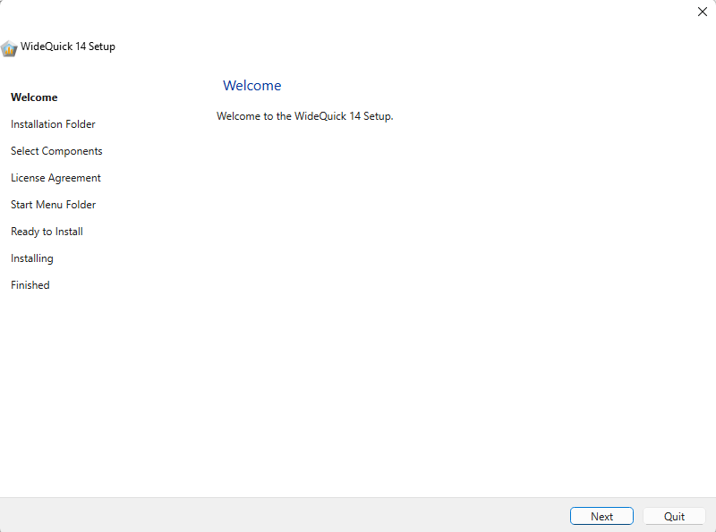
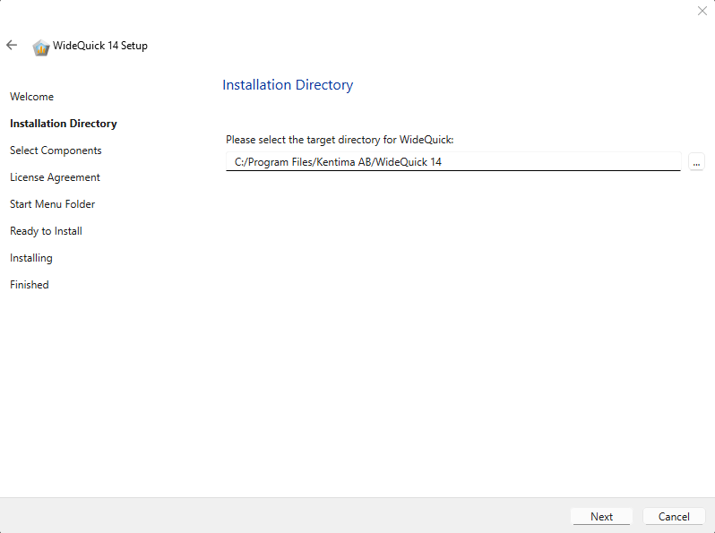
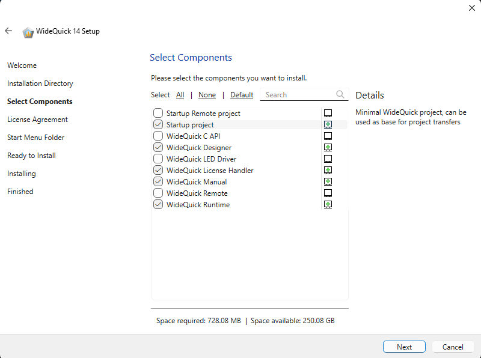
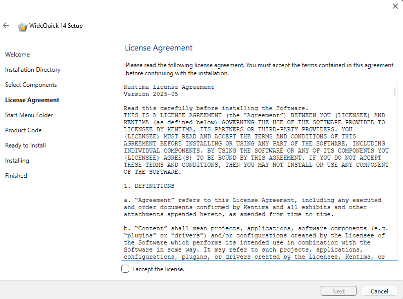
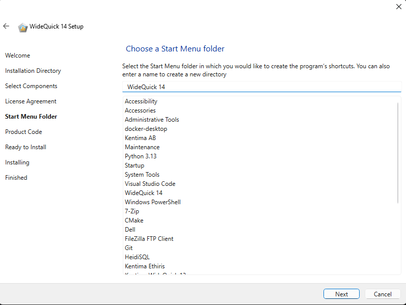
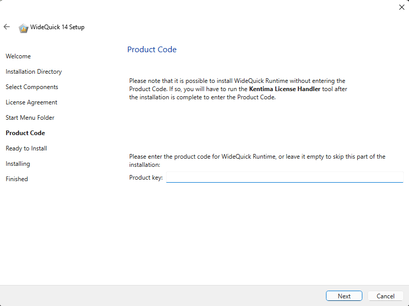
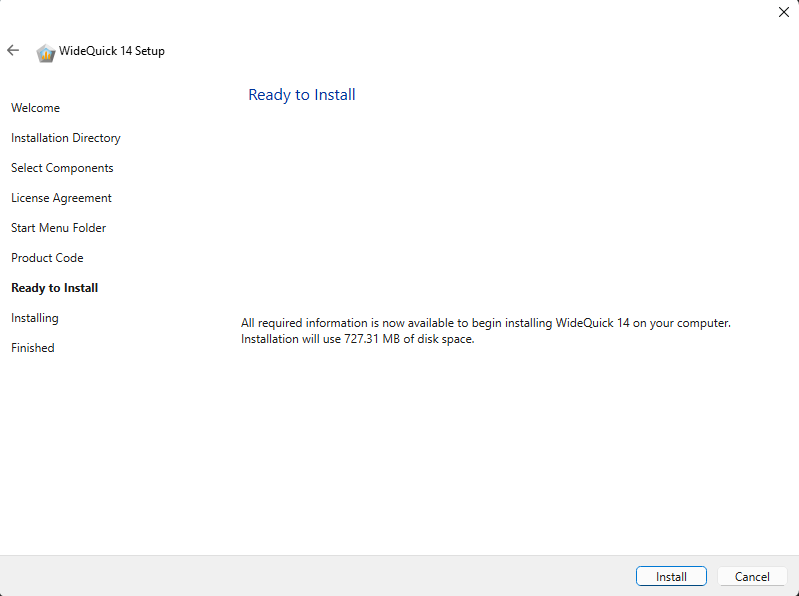
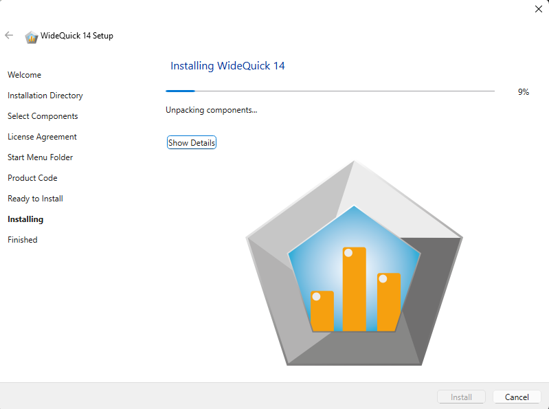
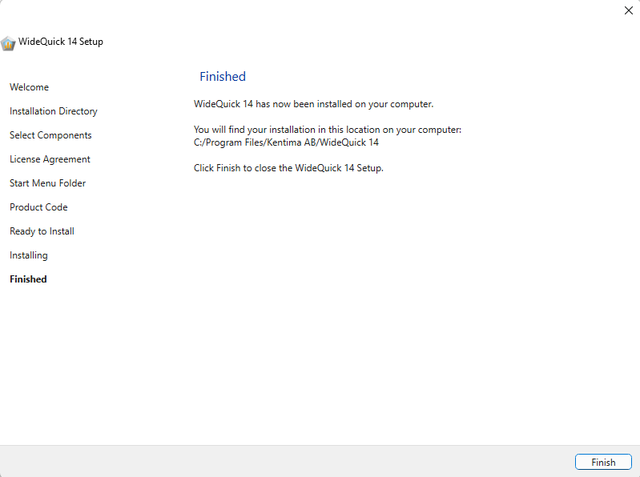

# Installing WideQuick

**WideQuick®** consists of three parts — **Designer**, **Runtime**, and **Remote**
— all installed from the same installation package.

**WideQuick® Designer** is the development environment used to build the user
interface for a project. It works with collaborative Workviews containing objects
connected to variables in the Data Store, creating dynamic effects. Objects and
Workviews appear static in Designer — the dynamics only come to life in Runtime.

**WideQuick® Runtime** is a standalone program installed on the target machine
together with a project created in Designer. When started, it presents the Workviews
and objects of the user interface, manages the Data Store, and handles communication
with I/O modules and OPC servers.

**WideQuick® Remote** makes it possible for one or more users to connect to the
same target system from different stations, enabling a client/server environment.
Using Designer, an overview Workview can also be created to present multiple target
systems simultaneously.

If more complex solutions are needed — such as custom control and regulation logic
— an application program can be combined with Runtime using the **WideQuick® C API**.
Application programs have the same access to Data Store variables as Runtime and can
be used to create tailored process control. The C API is not included in the standard
package.

The installation package is available for download from
<a href="https://www.kentima.com" target="_blank">kentima.com</a>.

## System requirements

To use **WideQuick® Designer**, **Runtime**, or **Remote**, the following minimum
hardware is required:

* An x86-64 (Intel 64/AMD64) processor
* 4 096 MB RAM
* 1 024 MB available disk space

**WideQuick®** products are supported on the following operating systems:

* Windows 10 (1809, 64-bit)
* Windows 11 (64-bit)
* Windows Server 2019 or newer (64-bit)
* Debian GNU/Linux 11.0 (64-bit)

## Installation procedure

Run the installation file on the computer where you wish to install **WideQuick®**.
The installer will guide you through the following steps.

!!! tip
    To install without any dialogs, for example from a script or with Intune,
    see [Installing from the command line](#installing-from-the-command-line).

### Welcome



The installer opens with a welcome screen showing all the steps that will be
completed during the installation. Click **Next** to begin.

### Installation Directory



Select the folder where **WideQuick®** will be installed. The default location is
`C:/Program Files/Kentima AB/WideQuick 14`. Click **...** to browse for a different
folder. Click **Next** to continue.

!!! tip
    The default installation folder is recommended for most installations.

### Select Components



Select the components to install. The bottom of the dialog shows the disk space
required for the selected components. Hovering over a component shows a description
in the **Details** panel on the right.

The available components are:

| Component | Description |
|---|---|
| **Startup Remote project** | An executable that allows remote access to a Runtime instance. Requires **WideQuick Remote** to also be installed. |
| **Startup project** | A minimal WideQuick project placed in the installation folder. Used as a base when transferring projects to the target machine. |
| **WideQuick C API** | API for integrating WideQuick with C-based applications, enabling custom control and regulation logic alongside Runtime. |
| **WideQuick Designer** | The development environment for building and configuring WideQuick projects. Does not require a product code. |
| **WideQuick LED Driver** | Driver for LED hardware integration. |
| **WideQuick License Handler** | Tool for viewing license information and upgrading licenses. |
| **WideQuick Manual** | The built-in help manual, accessible in **WideQuick® Designer** by pressing **F1**. |
| **WideQuick Remote** | Connects to a running Runtime instance from another machine, enabling a client/server environment. |
| **WideQuick Runtime** | Runs a WideQuick project on the target machine. |

#### Recommended configurations

**Development machine** — for building and test running projects on the same machine:

* **WideQuick Designer**
* **WideQuick Runtime**
* **WideQuick Manual**

**Runtime machine** — for running a project locally on the target machine:

* **WideQuick Runtime**
* **WideQuick License Handler**
* **Startup project**

**WideQuick Remote machine** — for running a project that can also be
accessed remotely:

* **WideQuick Runtime**
* **WideQuick Remote**
* **Startup project**
* **Startup Remote project**

### License Agreement



Read the license agreement carefully. Check **I accept the license** to accept the
terms and conditions. Click **Next** to continue.

!!! note
    You must accept the license agreement to proceed with the installation.

### Start Menu Folder



Select the Start Menu folder where **WideQuick®** shortcuts will be created. The
default is **WideQuick 14**. An existing folder can be selected from the list, or
a new name entered in the field at the top. Click **Next** to continue.

!!! tip
    The default folder name is recommended for most installations.

### Product Code



Enter the product key for **WideQuick® Runtime**. The product key can be found in
the purchase confirmation received from Kentima.

The product key can be left empty and entered later using the **WideQuick License
Handler** tool after installation is complete. Click **Next** to continue.

!!! note
    A product key is only required for **WideQuick® Runtime** and
    **WideQuick® Remote**. **WideQuick® Designer** does not require a product key.

### Ready to Install



All required information has been collected. The dialog shows the total disk space
that will be used by the installation. Click **Install** to begin the installation.

### Installing



The installer will now copy and unpack all selected components. A progress bar shows
the current status. Click **Show Details** to see a detailed log of the installation
process.

### Finished



**WideQuick 14** has been successfully installed. The dialog confirms the
installation location. Click **Finish** to close the installer.

**WideQuick® Designer** can now be launched from the Start Menu under
**WideQuick 14**.

!!! tip
    If you skipped entering the product key during installation, open the
    **WideQuick License Handler** from the Start Menu to enter it now.

## Installing from the command line

WideQuick® can be installed without any dialogs (a *silent install*), for example when the installation is scripted or deployed with Intune, SCCM or GPO. The installer is then run from the command line, and the choices normally made in the dialogs are given in advance.

How the choices are given depends on the version:

- **WideQuick 13.4 and earlier** use InstallShield. The choices are first recorded to a response file, which is then played back during the silent installation.
- **WideQuick 14** uses Qt Installer Framework. The choices are given directly as commands and options, and no response file is needed.

!!! warning "Requires administrator rights"
    Run the installation from a Command Prompt or PowerShell started as administrator, or as SYSTEM in a deployment tool.

### WideQuick 13.4 and earlier

In WideQuick 13.4 and earlier, WideQuick products are installed with InstallShield. A silent installation is then done in two steps:

1. The installation is first done manually and "recorded". The choices are saved to a response file (`.iss`).
2. The response file is then used to run the same installation silently from the command line on other computers.

!!! note
    The choices made during the recording also apply to the silent installation. For example, if only Designer is installed during the recording, only Designer is installed when the response file is used.

#### Record the installation

```
setup.exe /r /f1"C:\Temp\my-answer-file.iss"
```

- Replace `setup.exe` with the installation file, for example `"WideQuick 13.4.1.exe"`.
- Replace `C:\Temp\my-answer-file.iss` with the path where the response file should be saved.

The normal graphical installer starts. Make the choices that should apply and complete the installation.

#### Install from the recording

```
setup.exe /s /f1"C:\Temp\my-answer-file.iss" /f2"C:\Temp\my-install.log"
```

- Replace `setup.exe` with the installation file.
- Replace `C:\Temp\my-answer-file.iss` with the path to the recorded response file.
- Replace `C:\Temp\my-install.log` with the path where the log file should be saved. `/f2` is optional, but is needed to [check the result](#check-the-result).

| Option | Description |
|---|---|
| `/r` | Records the installation to a response file. |
| `/s` | Installs silently using a response file. |
| `/f1"<path>"` | Path to the response file. |
| `/f2"<path>"` | *(Optional)* Path to the log file for the silent installation. |

!!! note
    Give the full path to the files and do not put a space between `/f1` or `/f2` and the quotation mark.

#### Check the result

The result is written to the log file given with `/f2`, under `[ResponseResult]`:

| ResultCode | Meaning |
|---|---|
| `0` | The installation succeeded. |
| `-3` | The response file does not match the installer, for example if it was recorded with a different version or in a different mode. |

Other negative values mean that the installation failed.

### WideQuick 14

```
"WideQuick 14.0.3.exe" <command> [components ...] [options]
```

- **Command** – *what* to do, for example `install`. Written without dashes, and only one per run.
- **Components** – *which* parts to install, for example `wqruntime wqdesigner`.
- **Options** – *how* to do it, for example `--al`. Always start with `-` or `--`.

Replace the file name with the installation package you have downloaded.

!!! note
    No UAC dialog is shown in command-line mode. Without administrator rights, the installation stops with the error *Cannot elevate access rights while running from command line*.

#### Quick start

Install the default components (Runtime, Designer, Manual, Startup project and License Handler) to the default folder:

```
"WideQuick 14.0.3.exe" install --al --da -c
```

The same, but also with Remote and Startup Remote project:

```
"WideQuick 14.0.3.exe" install startupremote --al --da -c
```

#### Recommended configurations from the command line

The commands below correspond to the [Recommended configurations](#recommended-configurations) above. With `--nd`, only the components given are installed. For a development machine, the commands under [Quick start](#quick-start) are enough.

**Runtime machine:**

```
"WideQuick 14.0.3.exe" install startup com.kentima.licensehandler --nd --al --da -c
```

**WideQuick Remote machine:**

```
"WideQuick 14.0.3.exe" install startup startupremote --nd --al --da -c
```

#### Options

Both long and short names work, for example `--accept-licenses` is the same as `--al`. A fully silent installation needs `--al`, `--da` and `-c`.

| Option | Short | Description |
|---|---|---|
| `--accept-licenses` | `--al` | Accepts the license agreement. |
| `--default-answer` | `--da` | Answers all questions with the default answer. |
| `--confirm-command` | `-c` | Starts the installation without asking for confirmation. |
| `--no-default-installations` | `--nd` | Installs only the components given. See [What does --nd do?](#what-does-nd-do) |
| `--root <folder>` | `-t` | Installs to a folder other than the default folder. Use quotation marks if the path contains spaces. |
| `--accept-messages` | `--am` | Answers *Yes/OK* to all questions instead of the default answer. |
| `--reject-messages` | `--rm` | Answers *No/Cancel* to all questions. |
| `--auto-answer <id=value,...>` | `--aa` | Answers specific questions, for example `--aa TargetDirectoryInUse=Ok`. The question id is shown first on the line in the output. |
| `--no-size-checking` | `--ns` | Skips the free disk space check. |
| `--verbose` | `-d` | More detailed output, useful for troubleshooting. |
| `--help` | `-h` | Shows all available commands and options. |

!!! note
    Use only one of `--da`, `--am` and `--rm`.

##### What does --nd do?

The default components (Runtime, Designer, Manual, Startup project and License Handler) are preselected, just like the checked boxes in the [Select Components](#select-components) step. Components given after `install` are **added** to the preselected ones. `--nd` clears the preselected components first, so that only the ones given are installed.

| Command | Installs |
|---|---|
| `install` | The default components |
| `install wqremote` | The default components **and** Remote |
| `install wqremote --nd` | **Only** Remote |

Components that a selected component depends on are always installed automatically, even with `--nd`.

!!! note
    WideQuick License Handler is not included automatically when `--nd` is used. Add `com.kentima.licensehandler` if it is needed.

!!! tip
    Use `--nd` and list the components explicitly in scripts. That way the installation is not affected if the default selection changes in a future version.

#### Components

Components are given after `install`, separated by spaces. Most of them have a short alias. License Handler and C API have no alias and are given by package name.

| Component | Alias | Package name | Default |
|---|---|---|---|
| WideQuick Runtime | `wqruntime` | `com.kentima.wqruntime` | Yes |
| WideQuick Designer | `wqdesigner` | `com.kentima.wqdesigner` | Yes |
| WideQuick Manual | `wqmanual` | `com.kentima.wqmanual` | Yes |
| Startup project (incl. Runtime) | `startup` | `com.kentima.startup` | Yes |
| WideQuick License Handler | – | `com.kentima.licensehandler` | Yes |
| WideQuick Remote | `wqremote` | `com.kentima.wqremote` | No |
| Startup Remote project (incl. Remote) | `startupremote` | `com.kentima.startup_remote` | No |
| WideQuick LED Driver | `wqleddriver` | `com.kentima.wqleddriver` | No |
| WideQuick C API | – | `com.kentima.wqcapi` | No |

List the components in the installation package:

```
"WideQuick 14.0.3.exe" search
"WideQuick 14.0.3.exe" search --type package
```

!!! note
    Type `search`, not `install se`. `install se` stops with the error *2 commands provided, only one can be used at a time*.

#### Change or uninstall an existing installation

The installation package cannot install to a folder that already contains an installation. Use the maintenance tool `maintenancetool.exe` in the installation folder instead. It takes the same commands and options and must also be run as administrator.

**List installed components:**

```
"C:\Program Files\Kentima AB\WideQuick 14\maintenancetool.exe" list
```

**Add a component:**

```
"C:\Program Files\Kentima AB\WideQuick 14\maintenancetool.exe" install wqremote --al --da -c
```

**Remove a component** (give the package name, not the alias):

```
"C:\Program Files\Kentima AB\WideQuick 14\maintenancetool.exe" remove com.kentima.wqremote -c --da
```

**Uninstall everything:**

```
"C:\Program Files\Kentima AB\WideQuick 14\maintenancetool.exe" purge -c --da
```

!!! warning
    `purge` removes the entire installation folder, including files created after the installation, for example `wqservice.ini`. Back up such files first.

#### Upgrade within the same major version

To upgrade to a newer version within the same major version, for example from 14.0.2 to 14.0.3, the old version must be uninstalled first:

1. Back up your own files in the installation folder, for example `wqservice.ini`.
2. Uninstall the old version with `maintenancetool.exe purge -c --da`.
3. Install the new version with the components you want.
4. Put the backed-up files back.

!!! note
    A new major version, for example WideQuick 15, is installed in its own folder. The old version does not need to be uninstalled.

#### Deployment with Intune, SCCM or GPO

- The installation works when run as SYSTEM. The program is then registered for all users, and the shortcuts are placed in the common Start Menu.
- Use `--nd --al --da -c` and list the components explicitly.
- The Runtime installation creates the Windows service **WideQuick Runtime** with the startup type Manual.
- Check the exit code:

    | Exit code | Meaning |
    |---|---|
    | `0` | The installation succeeded. |
    | `1` | Error or cancelled installation. |
    | `3` | Unknown component, for example a misspelled alias. |

Example in PowerShell:

```powershell
$p = Start-Process "C:\Install\WideQuick 14.0.3.exe" -ArgumentList 'install startup com.kentima.licensehandler --nd --al --da -c' -Wait -PassThru
$p.ExitCode
```

!!! tip
    If something fails, run again with `-d` and save the output to a file, for example `> C:\Temp\wq_install.log 2>&1`. The installer also writes the log `InstallationLog.txt` in the installation folder.
